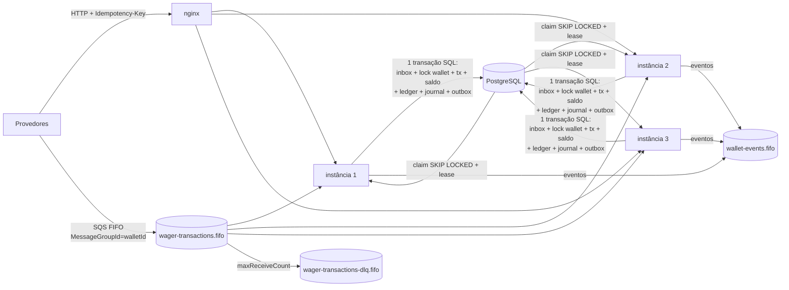

# ARCHITECTURE

Este documento registra **o que foi decidido, por quê, o que custou e o que ficou de fora**. A regra de ouro do desenho: **o banco é o árbitro final das invariantes financeiras**. O broker, os locks e o código de aplicação são camadas que tornam o caminho feliz rápido. Se qualquer uma delas falhar ou tiver bug, o PostgreSQL ainda recusa o estado inválido.

- [1. Visão geral](#1-visão-geral)
- [2. Decisões (ADRs)](#2-decisões-adrs)
- [3. Schema e invariantes no banco](#3-schema-e-invariantes-no-banco)
- [4. Regras de negócio e interpretações](#4-regras-de-negócio-e-interpretações)
- [5. Contratos: status HTTP, failureCode, eventos](#5-contratos)
- [6. Fluxos críticos](#6-fluxos-críticos)
- [7. Segurança](#7-segurança)
- [8. Escalabilidade e performance](#8-escalabilidade-e-performance)
- [9. Estratégia de testes](#9-estratégia-de-testes)
- [10. Limitações conhecidas e próximos passos](#10-limitações-conhecidas-e-próximos-passos)

---

## 1. Visão geral



Cada instância é stateless e roda os papéis definidos em `APP_ROLES`:
- `api`: HTTP;
- `consumer`: SQS;
- `outbox`: publisher;
- `pending-ref`: worker de referências.

Todos os papéis são seguros com N réplicas. As entradas HTTP e SQS convergem para **um único use case** (`ProcessWagerTransaction`), e todo efeito acontece numa **única transação SQL**.

**Camadas (hexagonal por contexto).** As dependências apontam sempre para dentro:

| Camada | Conteúdo | Depende de |
|---|---|---|
| `domain` | `Money`, `Wallet`, `WagerTransaction`, `WalletLedgerEntry`, `WagerProcessor`, `InboxMessage`, `OutboxMessage`, eventos | nada (só `decimal.js`) |
| `application` | use cases, portas (`UnitOfWork`, repositórios, `AppMetrics`, `AppLogger`), erros de aplicação | domínio |
| `infrastructure` | MikroORM, SQS, HTTP (Nest), workers, observabilidade | aplicação e domínio |

O Nest é só a casca HTTP/DI. O núcleo é montado sem framework em `src/composition/core.ts` e registrado no Nest como valores. A mesma instância serve HTTP, SQS e testes, e os testes de integração exercitam o mesmo grafo de objetos da produção.

---

## 2. Decisões (ADRs)

### ADR-01 — MikroORM 7, `defineEntity` e escritas explícitas

**Decisão.** MikroORM, a opção preferencial do enunciado. Entidades de persistência são definidas com `defineEntity`, sem decorators, e ficam separadas dos agregados de domínio. *Mappers* explícitos convertem `record ↔ domínio` usando `rehydrate`.

**Estratégia transacional.** Cada unidade de trabalho faz `orm.em.fork()`, que tem identity map isolado, e roda dentro de `em.transactional()` com `READ COMMITTED`. As escritas financeiras são explícitas: `insert`, `nativeUpdate … WHERE version = ?` e SQL nomeado para `ON CONFLICT` e `SKIP LOCKED`. **Não** usamos `flush()` com change tracking implícito no caminho do dinheiro. O ORM fornece a fronteira transacional, o pool, o mapeamento, as migrations e os locks (`LockMode.PESSIMISTIC_WRITE`). As escritas, por sua vez, ficam legíveis e auditáveis no código.

**Mapeamento do `Money`.** Valor e moeda ficam em colunas separadas: `amount NUMERIC(20,2)` e `currency CHAR(3)`. O tipo é `decimal("string")`: o driver `pg` devolve NUMERIC como **string exata**, e a string vai direto para `Money.fromSigned()`. Nenhum valor monetário passa por `number` em nenhum ponto (veja o ADR-02).

**Trade-off.** Há mais código de mapeamento do que com entidades ricas anotadas. Em troca, o domínio não conhece ORM nem Nest e pode ser testado sem banco. O perfil de CPU mostrou que `em.fork()` e a construção do EM custam cerca de 12% do CPU consumido (veja o [LOAD_TEST](docs/LOAD_TEST.md)). É aceitável, porque o processo é I/O-bound.

### ADR-02 — Dinheiro: `decimal.js` + `NUMERIC(20,2)` de ponta a ponta

- O contrato de entrada é **estrito**: `^(0|[1-9]\d{0,17})\.\d{2}$`. Exige exatamente 2 casas e rejeita sinal, expoente, `NaN`, `Infinity`, zeros à esquerda e string vazia. Isso torna "25.00" a única grafia de vinte e cinco, o que é essencial para o hash de idempotência.
- **Não existe arredondamento.** Entradas com mais de 2 casas são rejeitadas. Somas e subtrações de valores com 2 casas são exatas (`decimal.js` com 40 dígitos de precisão). Overflow além de `NUMERIC(20,2)` é erro, nunca truncamento.
- **`NUMERIC` não viola a restrição "não usar float".** É decimal exato. O risco real está na fronteira DB↔JS, coberta por:
  - um teste de integração que prova que o valor hidrata como `string`;
  - `bun run check:money`, um guard no CI que barra `parseFloat`, `Number()` em código de domínio, campos monetários tipados como `number` e tipos `real`/`float`/`double precision`/`money` em migrations.
- **O modelo é multi-moeda.** O enunciado permite assumir só `BRL`, desde que o modelo continue multi-moeda e os conflitos sejam testados. Aqui, N moedas funcionam de verdade:
  - a moeda é coluna em wallet, transação, ledger e journal. O banco garante uma wallet por `(player, currency)`, ledger na moeda da wallet e journal com uma única moeda por transação;
  - as contas de contrapartida são por moeda (`provider:{id}:{moeda}`, `system:funding:{moeda}`), então o journal nunca soma moedas diferentes;
  - um mesmo jogador tem uma wallet por moeda, e elas se movimentam de forma independente.
- **Moedas habilitadas são configuração.** `SUPPORTED_CURRENCIES` (padrão `BRL,USD,EUR`) é validada no boot contra a lista ISO-4217 do runtime (`Intl.supportedValuesOf`), então um erro de digitação impede a subida.

  | Situação | Resposta |
  |---|---|
  | Abrir wallet numa moeda habilitada | `201` |
  | Abrir wallet numa moeda ISO válida, mas não habilitada | `422 CURRENCY_NOT_SUPPORTED` |
  | Código que não é ISO-4217 (`XYZ`, `brl`) em qualquer contrato | `400` |
  | Aposta numa moeda válida, mas diferente da wallet | resultado de negócio `REJECTED(CURRENCY_MISMATCH)`: persistido, auditável e com replay (HTTP `422`; no SQS a mensagem é confirmada, não vai para a DLQ) |
  | Reversão em outra moeda (e, portanto, em outra wallet) | `REJECTED(REFERENCE_MISMATCH)`, sem tocar nenhuma das duas wallets |

  A lista controla só a **abertura** de wallets. Desabilitar uma moeda depois não congela as wallets existentes, que continuam aceitando estornos e reversões.
- **Limitação assumida: 2 casas decimais para todas as moedas.** O contrato e o `NUMERIC(20,2)` servem para BRL, USD e EUR. Moedas com 3 casas (KWD, BHD) não são representáveis, e moedas sem centavos (JPY, CLP) aceitariam centavos inexistentes. Suportá-las exigiria uma tabela de casas decimais por moeda (expoente ISO-4217) aplicada no `Money`, no contrato e nas constraints. Isso está fora do escopo do desafio.
- Alternativa descartada: `BIGINT` em centavos. Também é exato, mas a escala ficaria implícita no código e o `CHECK` aritmético do ledger perderia legibilidade.

### ADR-03 — Concorrência: lock pessimista por wallet + versão como defesa em profundidade

**Decisão.** A unidade de concorrência é a `walletId`. Cada operação que pode alterar saldo faz `SELECT … FROM wallets WHERE id = ? FOR UPDATE` (`LockMode.PESSIMISTIC_WRITE`) **antes** de qualquer leitura de regra. O saldo é gravado com `UPDATE … WHERE id = ? AND version = ?`, e se nenhuma linha for afetada a transação inteira é refeita. Para não esperar indefinidamente, usamos `SET LOCAL lock_timeout = 2s` e `statement_timeout`.

**Por que pessimista.** Numa hot wallet, o lock otimista transforma contenção em tempestade de retries: N−1 de N transações perdem e refazem tudo. O lock pessimista serializa as transações na fila do próprio PostgreSQL, com custo previsível. A `version` continua lá como segunda barreira, e o `UNIQUE(wallet_id, wallet_version)` do ledger é a terceira. Assim, um lost update vira violação de schema.

**Por que não há deadlock.** Cada transação trava **exatamente uma** wallet. O worker de referências segue a mesma ordem do caminho online (wallet → linha da transação). O "nudge" de dependentes só toca linhas da **mesma** wallet.

**Isolamento.** Usamos `READ COMMITTED` mais o lock de linha. Depois de obter o lock, cada statement enxerga os commits anteriores, então um replay concorrente vê o resultado original e o devolve. A reconciliação usa `REPEATABLE READ READ ONLY`: um snapshot consistente sem tocar no lock da hot wallet.

**Custo medido.** A vazão de uma única wallet é limitada pelo tempo de lock: cerca de 125 TPS no ambiente local, ou ~8 ms por transação (veja o [LOAD_TEST](docs/LOAD_TEST.md)). Wallets diferentes escalam em paralelo.

**Retry transitório.** `55P03` (lock timeout), `40P01` (deadlock), `40001` (serialization), perda de conexão, `OptimisticConcurrencyError` e corrida de idempotência fazem *rollback* e refazem **a transação inteira**. São no máximo 3 tentativas, com jitter. Esgotadas, o erro vira `TransientInfrastructureError` (HTTP 503 com `Retry-After`, ou backoff de visibilidade no SQS).

### ADR-04 — Idempotência persistente

- **A fonte da verdade é o banco.** `UNIQUE(provider_id, idempotency_key)` e `UNIQUE(provider_id, external_transaction_id)` em `wager_transactions`. Um cache em memória nunca participa da decisão.
- **Cada provedor tem o próprio espaço de chaves.** Na primeira versão a chave era única no sistema inteiro. A revisão de ponta a ponta mostrou dois problemas:
  - o provider B que reusasse uma chave do provider A recebia `409` com o `transactionId` do A no detalhe (vazamento entre provedores);
  - qualquer provedor podia "ocupar" chaves que outro usaria depois.

  A migration `Migration20261012000001ProviderScopedIdempotency` troca a constraint, e todas as buscas passam a ser por (provider, chave). O `down` recria a constraint global e falha se dois provedores já compartilharem uma chave, de propósito: um rollback nunca deve fundir submissões de provedores diferentes.
- **UUIDs normalizados para minúsculas na borda**, antes do hash, e de novo no use case como defesa. O PostgreSQL devolve UUIDs em minúsculas e o domínio compara ids como texto. Sem isso, um `walletId` em maiúsculas virava `500` (ou `FAILED` no SQS), e um `playerId` em maiúsculas virava uma rejeição terminal `WALLET_PLAYER_MISMATCH`, presa à chave de idempotência. Agora as duas grafias são a mesma requisição (replay).
- **Avaliação após o lock da wallet.** Duplicatas concorrentes da mesma operação ficam na fila do lock. A segunda vê a primeira já commitada e responde com replay. Uma única query cobre as duas chaves.
- **Replay devolve o resultado original**, inclusive o saldo observado naquele momento (`result_balance_amount`), com `idempotentReplay: true` e o header `Idempotent-Replayed: true`.
- **Mesma chave com payload diferente** gera `409 IDEMPOTENCY_CONFLICT` (`PAYLOAD_MISMATCH`). Mesmo `(provider, externalId)` com outra chave gera `EXTERNAL_ID_REUSED`.
- **`payloadHash` = `"v1:" + hex(sha256(canonicalJson(campos)))`**:
  - campos: `providerId, externalTransactionId, playerId, walletId, roundId, gameId, kind, money{amount,currency}, referenceExternalTransactionId`;
  - JSON canônico: chaves ordenadas recursivamente, sem espaços, propriedades `undefined` omitidas (ausente ≡ undefined), números proibidos (todo campo de negócio é string);
  - o header `Idempotency-Key`, o `messageId` e os metadados de transporte **não** entram no hash;
  - o prefixo de versão permite evoluir o algoritmo sem colisões.
- **SQS:** há um inbox persistente `PK(consumer_name, message_id)`, inserido como **primeiro** statement da transação (`ON CONFLICT DO NOTHING`):
  - uma reentrega concorrente bloqueia nesse índice até o commit da original e então é reconhecida como duplicata;
  - o mesmo `messageId` com corpo diferente é conflito e vai para a DLQ;
  - um `messageId` novo com uma chave já processada cai na idempotência de negócio (replay).
- **Retenção do inbox:** 30 dias, configurável. O inbox é só uma janela de dedup de transporte. A idempotência de negócio é permanente, via constraints, então expurgar o inbox nunca reabilita efeito duplicado.

### ADR-05 — Referências fora de ordem

- Uma transação que **declara** referência (obrigatória para REFUND e ROLLBACK, opcional para WIN e LOSS → BET) só é aplicada quando a referência existe e está `PROCESSED`. Se a referência não existe, ou ela própria está `PENDING_REFERENCE`, a transação fica `PENDING_REFERENCE` (HTTP 202) e emite `WagerTransactionPendingReference`.
- **Worker agendado** (`pending-ref`):
  - faz o claim com `FOR UPDATE SKIP LOCKED` e empurra `next_reference_retry_at` como lease, assim uma instância que morre libera o trabalho sozinha;
  - processa cada item na sua própria transação, travando wallet → transação;
  - usa backoff exponencial `2s·2ⁿ` com jitter e teto de 5 min.
- **Orçamento: 10 tentativas (~35 min).** Provedores enviam a operação referenciada em segundos ou minutos. Um orçamento maior prenderia dinheiro "no limbo" e atrasaria a resposta definitiva ao provedor. Esgotado o orçamento, a transação vira `REJECTED(REFERENCE_NOT_FOUND)` e o evento correspondente é publicado.
- **Nudge:** quando a referência chega e fica **terminal**, a mesma transação SQL marca os dependentes da mesma wallet como devidos *agora*. A latência de resolução cai de "próximo backoff" para "próximo poll" (~1 s). O worker continua sendo a garantia.
  - `PROCESSED` libera os dependentes.
  - `REJECTED` ou `FAILED` faz com que eles virem `REFERENCE_NOT_PROCESSED` imediatamente. Antes, só `PROCESSED` acelerava, e o dependente de uma referência rejeitada esperava o próprio backoff (até 5 min) para receber a mesma resposta.

### ADR-06 — Transactional outbox

- O evento é gravado na **mesma transação SQL** do efeito financeiro. Nada é publicado a partir de linhas não commitadas.
- **Claim com lease:**
  - `UPDATE … SET locked_until, locked_by FROM (SELECT … FOR UPDATE SKIP LOCKED ORDER BY seq LIMIT n)`, numa transação curta;
  - a publicação acontece fora de transação;
  - depois vem `markPublished`, ou `scheduleRetry` com backoff.
  - Se o processo morre entre o claim e o mark, a lease expira e **outra instância republica**. Isso foi testado com `SIGKILL` real.
- **At-least-once.** `eventId` = id da outbox = `MessageDeduplicationId` do SQS. A dedup do broker (janela de 5 min) é otimização; o consumidor deve deduplicar por `eventId`.
- **Ordem:** `aggregateId = walletId` = `MessageGroupId`. O publisher divide o lote em *lanes* por hash do `aggregateId`: cada wallet publica sequencialmente em ordem de `seq`, e lanes diferentes publicam em paralelo. Uma falha **interrompe a lane**, para não publicar eventos de uma wallet "por cima" de um buraco. Entre publishers diferentes a ordem é *best effort*. Os eventos carregam `walletVersion` para o consumidor ordenar ou ignorar eventos obsoletos.
- No shutdown, o publisher devolve as leases imediatamente (`releaseLeases`).

### ADR-07 — Consumidor SQS

- **Mesmo use case** do HTTP. O ack (`DeleteMessage`) acontece **somente após o commit**.
- **Classificação:**
  - **negócio** (PROCESSED, REJECTED, PENDING_REFERENCE): commit e ack;
  - **transitório**: `ChangeMessageVisibility` com backoff baseado em `ApproximateReceiveCount`. Na última tentativa permitida (`maxReceiveCount = 5`), a falha é auditada como `RETRIES_EXHAUSTED` (`retryable: true`) e a mensagem vai explicitamente para a DLQ. Ela continua recuperável por redrive;
  - **erro inesperado** (defeito) na última tentativa: a transação vira `FAILED(INFRA_PERMANENT_FAILURE)`, é auditada e vai para a DLQ (veja o ADR-12);
  - **permanente** (JSON inválido, schema inválido, conflito de idempotência, wallet inexistente): auditoria, envio explícito à DLQ com atributo `failureReason` e delete.
- Toda mensagem que vai para a DLQ deixa uma linha de auditoria e um evento `WagerSubmissionFailed`. A redrive policy continua como rede de segurança para mensagens que derrubam o próprio consumidor.
- Mensagens do mesmo `MessageGroupId` (wallet) num mesmo receive são aplicadas **em lote, numa única transação SQL e na ordem de chegada** (ADR-14), com ack em lote depois do COMMIT. Grupos diferentes rodam em paralelo. O FIFO do broker é otimização de ordem, não garantia de consistência.
- **Heartbeat de visibilidade desde o receive até o settle**, por mensagem. Isso inclui as que esperam a vez atrás de outras do mesmo grupo ou no fallback do lote. Assim, um grupo lento nunca deixa uma mensagem ainda em posse da instância reaparecer na fila. No shutdown, o heartbeat é parado antes de a mensagem ser devolvida com `visibility = 0`.
- O inbox de um lote é inserido em ordem de `messageId`. Dois lotes que compartilham mensagens podem esperar um pelo outro, mas não entram em deadlock.
- **`SIGTERM`:**
  1. a readiness passa a 503;
  2. o polling para (o long poll é abortado);
  3. as mensagens em andamento terminam dentro do grace period;
  4. as recebidas e não iniciadas voltam com `visibility = 0`;
  5. os workers param e liberam as leases;
  6. o HTTP fecha;
  7. o pool fecha.

### ADR-08 — Ledger de partidas dobradas (diferencial)

- `wallet_ledger_entries` continua sendo o **sub-ledger** da wallet, com `balance_before/after` e `wallet_version`.
- O **journal** `ledger_postings` registra as duas pernas de cada movimento:
  - `wallet:{id}`;
  - a contrapartida: `provider:{providerId}:{ccy}` (clearing) ou `system:funding:{ccy}` (OPENING).
- Um *constraint trigger* diferido exige Σdébitos = Σcréditos por transação no COMMIT. Outro exige que toda linha do sub-ledger tenha a sua perna no journal.
- **As contas de contrapartida não têm saldo materializado.** Uma linha "house" atualizada a cada aposta seria um lock **global** compartilhado por todas as wallets, que é exatamente o que o enunciado proíbe. Os saldos dessas contas são derivados sob demanda (`SUM`).
- A migration é separada, reversível e faz **backfill** do histórico.

### ADR-09 — Autenticação: ponto de extensão, não implementação

Autenticação não pontua, então o tempo foi para correção. Existe `ProviderIdentityPort`, implementado por `NoopProviderIdentity`. A **autenticação** é o ponto de extensão; a **autorização** é real e está testada com um adapter de identidade de teste (`hardening.test.ts`). O `ProviderAuthGuard` é **global**:
- resolve o principal (`providerId`, `subject`, `scopes`); sem credencial, responde `401`;
- marca health e metrics como `@Public()`;
- **exige um escopo por rota e nega por padrão**: uma rota nova sem `@RequireScope` responde `403`, nunca fica aberta por esquecimento;
- garante que um provider só atua sobre o próprio `providerId` (body ou path);
- o adapter no-op devolve um principal `*` confiável, com todos os escopos.

| Escopo | Rotas | Quem recebe |
|---|---|---|
| `wagers:submit` | `POST /wagering/transactions` | provedor |
| `wagers:read` | `GET /wagering/transactions/:id`, `GET /providers/:p/...` (transação e falhas) | provedor |
| `wallets:read` | `GET /wallets/:id`, `GET /wallets/:id/ledger` | back-office (ou um agregador confiável) |
| `wallets:manage` | `POST /wallets` (o saldo de abertura **cria dinheiro**), `POST /wallets/:id/reconciliation` | back-office |

**Propriedade do recurso.** Em `GET /wagering/transactions/:id`, uma transação de outro provedor responde `404`, igual a uma inexistente: ids não podem ser sondados. A wallet não pertence a um provedor (o jogador joga em vários), por isso o acesso a ela é controlado por escopo, não por dono. Restringir a leitura de saldo ao jogador da sessão exigiria o *launch token* do jogo, fora do escopo.

**Desenho de produção (Keycloak ou Zitadel):**
- cada provedor é um *client* OIDC com `client_credentials`;
- um `JwtProviderIdentity` valida o bearer via JWKS do IdP (com cache e rotação), checando `iss`, `aud` e `exp`;
- ele mapeia a claim `provider_id` e o `scope` do token para o principal;
- o guard já impõe os escopos e `principal.providerId === body.providerId`;
- mensagens SQS são canal interno confiável (escopo do enunciado), mas a identidade do provedor na mensagem continua sujeita às mesmas validações de domínio.

### ADR-10 — Observabilidade

- **Logs** pino em JSON. Um `AsyncLocalStorage` injeta `correlationId`, `messageId`, `transactionId`, `walletId`, `providerId`, `channel` e `traceId` em toda linha. Valores monetários e payloads **não são logados**: o código não os passa, e a configuração do pino faz `redact` como defesa em profundidade.
- **Métricas** prom-client em `/metrics`:
  - `wager_transactions_total{kind,status,channel}`;
  - `wager_idempotent_replays_total`, `wager_idempotency_conflicts_total`, `inbox_duplicates_total`;
  - `db_transient_retries_total`, `db_lock_conflicts_total`;
  - `sqs_messages_total{result=ack|retry|dlq|duplicate}`, `sqs_dlq_depth`;
  - `outbox_lag_seconds` (idade do evento mais antigo não publicado), `outbox_publish_lag_seconds` (commit → broker), `outbox_pending_messages`;
  - `wager_processing_duration_seconds`, `pending_reference_transactions`, `reconciliation_mismatches_total`;
  - `wager_submission_failures_total{channel,reason}` (auditoria, ADR-12).
- **Health:** `live` é só o processo, porque uma queda do banco não deve reiniciar pods. `ready` checa PostgreSQL e SQS com timeout e cache de 2 s, e responde 503 durante o shutdown. É público (o enunciado exige health sem autenticação) e passa pela borda, por isso o corpo só diz `ok` ou `unavailable` por dependência: o erro do driver, que pode citar host, porta ou usuário internos, vai só para o log.
- **Tracing:** OpenTelemetry via `--preload`. Inclui auto-instrumentação de HTTP e `pg` (validada no Bun) e spans manuais de consumo SQS e outbox. O W3C trace context é propagado em atributos SQS. Fica desligado por padrão.
- **Dashboard** Grafana provisionado com 14 painéis: lag, DLQ, latência p50/p95/p99, idempotência, locks, outbox e event loop.

### ADR-11 — MiniStack em vez de LocalStack

Desde março de 2026 a imagem da LocalStack exige *auth token*, inclusive no antigo plano Community. O MiniStack (MIT) foi validado num spike para tudo o que o desafio precisa: FIFO, deduplicação, `ApproximateReceiveCount`, `ChangeMessageVisibility` e redrive para DLQ.

Há uma ressalva: em envios deduplicados, o MiniStack devolve o MD5 da mensagem **original**, o que dispara `InvalidChecksumError` no SDK. A verificação de MD5 é desligada **só** quando `SQS_VERIFY_MD5=false` (emuladores). O endpoint é configurável, e trocar por LocalStack ou AWS real é questão de variável de ambiente.

### ADR-12 — Auditoria de submissões recusadas e status `FAILED`

**Problema.** Na primeira versão, uma submissão que não virava resultado de negócio (payload inválido, conflito de idempotência, wallet inexistente, mensagem envenenada, retries esgotados) deixava rastro só na DLQ e nos logs. Isso tinha dois defeitos:
- **o provedor não tinha como saber o que aconteceu**, sobretudo no canal SQS, que não recebe resposta síncrona;
- **a auditoria dependia de infraestrutura volátil**: a DLQ tem retenção limitada e os logs não são consultáveis pelo cliente.

**Por que não gravar tudo como `FAILED` em `wager_transactions`.** Essa foi a primeira ideia, e foi descartada caso a caso:

| Caso | Por que não cabe como linha `FAILED` |
|---|---|
| Payload ou mensagem malformados | não há identidade válida (wallet, provider, chave) para gravar |
| Conflito de idempotência | a chave já pertence à transação original (`UNIQUE`) |
| Wallet inexistente | a FK `wallet_id → wallets` impede a linha |
| Falha transitória esgotada (banco fora por minutos) | `FAILED` é **terminal**: com idempotência, todo reenvio com a mesma chave devolveria `FAILED` para sempre, transformando um problema recuperável numa resposta definitiva |

**Decisão.** São dois mecanismos, cada um com o seu papel:

1. **`wager_submission_failures`: trilha de auditoria fora do estado financeiro.**
   - O que registra: canal; `reasonCode` estável; categoria (`VALIDATION`, `CONFLICT`, `UNPROCESSABLE` ou `INFRASTRUCTURE`); se é `retryable`; os identificadores conhecidos (provider, externalId, chave, wallet, messageId); hash do payload quando válido; detalhe truncado; `receiveCount`; `correlationId`.
   - **Não ocupa a chave de idempotência.** O provedor pode corrigir e reenviar com a mesma chave, e isso está testado.
   - As linhas são **imutáveis** (trigger bloqueia `UPDATE`). `DELETE` é permitido só para retenção (`SUBMISSION_FAILURE_RETENTION_DAYS`, padrão 90 dias).
   - Os identificadores são **sanitizados no domínio**: só valores bem formados entram, então lixo enviado por um cliente quebrado ou mal-intencionado não chega ao banco. Valores e payloads não são armazenados, só o hash.
   - O registro roda numa transação **separada** e é **best-effort**: se o banco for o problema, o erro original ainda chega ao cliente.
   - Cada registro gera, na mesma transação, o evento **`WagerSubmissionFailed`** via outbox. É assim que um provedor do canal SQS fica sabendo da recusa.
   - O provedor consulta em `GET /providers/:providerId/wagering/transactions/:externalTransactionId/failures`.
   - Falhas transitórias no **HTTP** (503) não são auditadas: o cliente já recebeu a resposta síncrona com `Retry-After`, as métricas contam, e gravar uma linha por tentativa durante um incidente de banco só aumentaria a carga.
   - No **HTTP** só são gravadas falhas **atribuíveis**, isto é, com `providerId` e `externalTransactionId` válidos. São as únicas que algum provedor consegue consultar. Gravar lixo anônimo deixaria qualquer cliente transformar requisições inválidas e baratas em linhas no banco, eventos na outbox e mensagens no broker (amplificação de escrita). As demais só incrementam a métrica `wager_submission_failures_total`. No SQS, que é canal interno, toda mensagem enviada à DLQ continua auditada.
2. **`FAILED` em `wager_transactions` só para defeito confirmado.** Um erro **inesperado**, que não é de negócio nem transitório conhecido, e que sobreviveu a todas as tentativas no SQS indica bug. Nesse caso:
   - a transação é gravada como `FAILED(INFRA_PERMANENT_FAILURE)` com o saldo observado (inalterado) e **sem ledger**;
   - o evento `WagerTransactionFailed` é emitido;
   - a auditoria aponta o `transactionId`;
   - o replay devolve `422` com `status: FAILED`.

   Assim o provedor recebe uma resposta definitiva, em vez de silêncio. `FAILED` nunca sobrescreve um resultado real: se a chave já tiver uma transação, ela é devolvida.

**Efeito colateral corrigido:** a métrica `wager_idempotency_conflicts_total` existia, mas não era incrementada. Agora a auditoria a alimenta.

### ADR-13 — Cache (Redis): avaliado e não adotado

O teste de carga mostrou que o processo é **I/O-bound no caminho de escrita**: o app fica ocioso ~93% do tempo, esperando os round-trips ao PostgreSQL feitos sob o lock da wallet. Um cache não alivia esse caminho:
- **não pode** garantir idempotência (restrição 2 do enunciado);
- **não pode** fornecer o saldo para decisões, que precisa ser lido sob o lock;
- um lock distribuído no Redis acrescentaria um ponto de falha sem dispensar o lock do banco.

Usos legítimos existiriam: transações terminais e páginas antigas do ledger, que são imutáveis; o saldo para exibição invalidado por `WalletBalanceChanged`; um atalho de replay; e rate limiting no gateway. Mas atendem leituras e cenários que não são o gargalo medido.

**Decisão:** não introduzir Redis agora. Ele teria custo operacional (mais um componente e mais um modo de falha) sem ganho no caminho crítico. As alavancas reais de vazão estão na seção 8.

### ADR-14 — Lote por wallet no consumidor SQS

**Problema.** O teto de uma wallet é o tempo de lock: cada operação paga lock, ~10 idas ao banco e um COMMIT. Provedores costumam enviar rajadas para a **mesma** wallet (giros de slot, apostas e acertos de uma rodada). Processá-las uma a uma repete esse custo N vezes.

**Decisão.** O consumidor agrupa as mensagens de cada receive por wallet e chama `ProcessWagerTransaction.executeBatch`, que aplica as N operações numa **única transação SQL**:
1. insere o inbox de todas as mensagens (`INSERT` multi-linha `ON CONFLICT DO NOTHING RETURNING`);
2. trava a wallet **uma vez**;
3. busca idempotência e referências com **uma query cada** (mais uma para as já revertidas);
4. aplica as regras **em memória, na ordem de chegada**;
5. grava com `INSERT`s multi-linha (transações, ledger em ordem de versão, journal, outbox), **um** `UPDATE` da wallet e um `UPDATE` de dependentes;
6. faz o COMMIT;
7. dá o ack de todas com `DeleteMessageBatch`.

**Equivalência com o processamento um a um.** Essa é a regra que norteou o desenho:
- **Overlay em memória.** Cada item enxerga o que os anteriores do mesmo lote criaram:
  - uma `BET` e o seu `ROLLBACK` no mesmo lote;
  - um `REFUND` seguido de `ROLLBACK` da mesma `BET`, em que o segundo é rejeitado como já revertido;
  - chave repetida, que vira replay;
  - payload divergente, que vira conflito;
  - `externalId` reutilizado;
  - o mesmo `messageId` duas vezes, em que a cópia espelha a primeira.
- **Teste de equivalência.** Uma sequência com todos esses casos, mais referência fora de ordem e saldo insuficiente, é aplicada em lote numa wallet e uma a uma noutra. Os resultados por item, o saldo, a versão e o ledger precisam ser idênticos ([wager-batch.test.ts](test/integration/wager-batch.test.ts)).
- **Um único algoritmo.** O HTTP chama `execute`, que é um lote de 1. Toda a suíte existente valida o mesmo código.

**Falhas.**
- **Recusa de um item** (conflito, validação): só esse item vai para a DLQ, com auditoria. O registro de inbox dele é removido na mesma transação, para que uma reentrega ou redrive seja reavaliada como se a transação tivesse sido revertida.
- **Falha do lote inteiro** (wallet inexistente, transitória esgotada, erro inesperado): cada mensagem cai no caminho individual. Esse caminho tem a classificação completa (orçamento de retries, `FAILED`, auditoria). **O lote nunca muda o resultado de uma mensagem, só quantas transações ela custa.**

**Mudança no schema** (migration `Migration20261011000001BatchWalletVersion`, reversível). Um lote salva a wallet uma vez, com a versão avançando N, e o saldo pode até terminar igual (BET 10 + WIN 10 = +2 versões). A regra de linha "versão +1 se e só se o saldo muda" foi trocada por "a versão nunca diminui e o saldo não muda sem a versão aumentar". A garantia de verdade continua no schema e **não mudou**:
- `UNIQUE (wallet_id, wallet_version)` + trigger de cadeia: versões contíguas, cada uma continuando a anterior;
- *constraint trigger* diferido: no COMMIT, `(version, balance)` da wallet é o último elo da cadeia.

Um salto de N só é aceito se as N linhas existirem. Saltos com buracos continuam barrados, e há teste para isso.

**Resultado medido** (drenagem de uma fila pré-carregada, [LOAD_TEST](docs/LOAD_TEST.md)):
- **Tráfego concentrado** (10 wallets): **3,5× menos transações SQL** (4,3 mensagens por transação), **+48% de vazão** e o CPU do emulador cai de 79% para 42% com o ack em lote.
- **Tráfego espalhado** (100 wallets): cada receive traz no máximo 10 mensagens de vários grupos, o lote fica em ~1 por wallet e **não há ganho**. Isso é esperado: o lote ataca o teto por wallet, não a vazão global.

**Configuração:** `SQS_BATCH_PER_WALLET` (padrão `true`; `false` volta ao processamento um a um).

**Regressão encontrada no caminho:** ao revisar o algoritmo, apareceu um bug que já existia no caminho individual. Numa rejeição `REFERENCE_MISMATCH` cuja referência era de **outra wallet**, o processor gravava o vínculo `reference_transaction_id`, a FK composta recusava o INSERT e o resultado era 500 em vez de 422. Corrigido: só se vincula referência da mesma wallet. Há teste de regressão.

---

## 3. Schema e invariantes no banco

Migrations escritas à mão, versionadas e reversíveis (`up`/`down`, testadas), executadas pelo role `wagering_migrator`. A aplicação roda como `wagering_app`, que **não tem** `UPDATE/DELETE/TRUNCATE` no ledger nem no journal, nem DDL.

| Garantia | Mecanismo |
|---|---|
| Uma wallet por `(player, currency)` | `UNIQUE wallets_player_currency_uk` |
| Saldo nunca negativo | `CHECK (balance_amount >= 0)` em wallets; `CHECK` em `balance_before/after` no ledger |
| Valores positivos (LOSS pode ser 0) | `CHECK (amount > 0 OR (kind='LOSS' AND amount=0))`; ledger `amount > 0` |
| A versão nunca diminui e o saldo não muda sem a versão aumentar (um lote avança N de uma vez, ADR-14) | trigger `wallets_update_guard` (migration `BatchWalletVersion`) |
| Colunas de identidade imutáveis; wallets nunca deletadas | trigger `wallets_update_guard` |
| Aritmética de cada lançamento | `CHECK ledger_arithmetic_ck` (`after = before ± amount`) |
| No máximo um lançamento por transação e wallet | `UNIQUE (transaction_id, wallet_id)` |
| Lost update impossível | `UNIQUE (wallet_id, wallet_version)` |
| Cadeia do ledger contínua | trigger `ledger_entry_chain_guard` (o `before` de v*n* = o `after` de v*n−1*) |
| Toda alteração de saldo tem lançamento e vice-versa | *constraint triggers* **diferidos** `wallets_ledger_consistency` / `wallet_ledger_entries_wallet_consistency` |
| Só transações `PROCESSED` que movem saldo têm ledger, com mesmo valor e moeda | constraint trigger diferido `ledger_entry_transaction_guard` |
| Ledger e journal append-only | triggers `BEFORE UPDATE/DELETE/TRUNCATE` + `REVOKE` |
| Idempotência | `UNIQUE (provider_id, idempotency_key)`, `UNIQUE (provider_id, external_transaction_id)` |
| Referência na mesma wallet | FK composta `(reference_transaction_id, wallet_id) → (id, wallet_id)` |
| Reversão única | índice único **parcial** `(reference_transaction_id) WHERE kind IN ('REFUND','ROLLBACK') AND status='PROCESSED'` |
| Transações terminais imutáveis; colunas de negócio sempre imutáveis; nada é deletado | trigger `wager_transactions_guard` |
| Coerência de estado | `CHECK`: REFUND/ROLLBACK exigem referência; REJECTED/FAILED ⇔ `failure_code`; terminal ⇔ `processed_at`; PENDING_REFERENCE ⇔ `next_reference_retry_at` |
| Journal balanceado | constraint trigger diferido `ledger_postings_balanced` |
| Inbox | `PK (consumer_name, message_id)` |
| Auditoria de recusas imutável, fora do estado financeiro | `wager_submission_failures` + trigger que bloqueia `UPDATE`; `CHECK` de canal, categoria e formato do `reason_code`; o role de runtime tem só `SELECT, INSERT, DELETE` (retenção) |

Todas essas garantias têm teste que tenta violá-las com SQL direto ([schema-constraints.test.ts](test/integration/schema-constraints.test.ts)).

**Índices** pensados para o caminho quente e para os workers:
- únicos acima;
- parciais `WHERE status='PENDING_REFERENCE'` (due e lookup);
- parcial `WHERE published_at IS NULL` na outbox;
- `(wallet_id, created_at)`;
- `(account, created_at)` no journal.

**Paginação do ledger:** keyset em `wallet_version DESC`. O cursor é `base64url({"v":n})`, opaco e estável, porque a versão é imutável e monotônica por wallet.

---

## 4. Regras de negócio e interpretações

| Operação | Saldo | Ledger | Regras |
|---|---|---|---|
| `BET` | débito | 1 `DEBIT` | sem saldo → `REJECTED(INSUFFICIENT_FUNDS)` |
| `WIN` | crédito | 1 `CREDIT` | referência opcional; se declarada, precisa ser uma `BET` da mesma rodada/wallet/player/moeda |
| `LOSS` | — | — | `PROCESSED` sem mover saldo; referência opcional à `BET` |
| `REFUND` | crédito | 1 `CREDIT` | só referencia `BET` `PROCESSED`; valor igual; uma vez |
| `ROLLBACK` | inverso da referência | 1 invertido | referencia `BET`/`WIN`/`REFUND` `PROCESSED`; valor igual; uma vez; saldo negativo → `REJECTED(REVERSAL_INSUFFICIENT_FUNDS)` |
| `OPENING` | crédito | 1 `CREDIT` | interno; rejeitado pela API e pela fila |

**Máquina de estados** (`WagerTransaction`):

```
PENDING ──► PROCESSED | REJECTED | FAILED | PENDING_REFERENCE
PENDING_REFERENCE ──► PROCESSED | REJECTED | FAILED      (scheduleReferenceRetry não muda o estado)
PROCESSED, REJECTED, FAILED: terminais — transicionar é erro de programação (InvalidTransactionStateError)
```

`PENDING` é transitório em memória: a transação nasce e é decidida na mesma transação SQL, então nunca é persistida como PENDING. `FAILED` é usado só quando um erro **inesperado** esgota as tentativas no SQS (ADR-12): a transação fica terminal, auditável e sem efeito no saldo. As demais recusas (payload inválido, conflito, wallet inexistente, transitórias) ficam na trilha `wager_submission_failures`, que não ocupa a chave de idempotência.

**Interpretações adotadas** (o enunciado pede que sejam documentadas):
1. **Reversão única no total.** A regra 4 diz "pelo mesmo tipo", mas permitir `REFUND` **e** `ROLLBACK` da mesma `BET` creditaria duas vezes. Adotamos a regra mais estrita: uma referência é revertida no máximo uma vez, por REFUND ou ROLLBACK, o que for `PROCESSED` primeiro. Para desfazer um REFUND, usa-se `ROLLBACK` *do REFUND*. ROLLBACK de ROLLBACK não é permitido.
2. **Referência declarada é dependência.** Um WIN ou LOSS com `referenceExternalTransactionId` espera a BET chegar, como um REFUND ou ROLLBACK.
3. **A rejeição de wallet inexistente não é persistida** (`422 WALLET_NOT_FOUND` / DLQ). Não há wallet para travar nem FK válida. Um reenvio após a criação da wallet é processado normalmente.
4. **A rejeição carrega o saldo observado** (inalterado) e é idempotente: o replay devolve o mesmo 422.
5. **WIN sem referência** é aceito (crédito avulso do provedor).
6. **`amount` com exatamente 2 casas** no contrato. "25" e "25.5" são rejeitados (400) e nunca normalizados.
7. **`providerId = "system"` é reservado** para OPENING.
8. **Timestamps são informativos.** Ordem é `version`. Sob carga foi observado *clock skew* de mais de 125 ms entre instâncias. O `updatedAt` da wallet é mantido monotônico no domínio, e a constraint `updated_at >= created_at` foi quem revelou o problema.

---

## 5. Contratos

### Mapeamento HTTP

O mesmo código para a primeira execução e para o replay. `idempotentReplay` e `Idempotent-Replayed` distinguem os dois casos.

| Situação | Status | Corpo | Provedor deve… |
|---|---|---|---|
| Processada | **201** | `{transactionId, status:"PROCESSED", balance, idempotentReplay}` | seguir |
| Aceita, aguardando referência | **202** | `status:"PENDING_REFERENCE"` | consultar depois ou ouvir eventos |
| Rejeição de negócio (persistida) | **422** | `status:"REJECTED", failureCode` | não reenviar (ver ação na taxonomia) |
| Falha permanente auditada (`FAILED`, só via SQS, ADR-12) | **422** | `status:"FAILED", failureCode:"INFRA_PERMANENT_FAILURE"` | não reenviar; acionar suporte |
| Payload inválido / header ausente / `OPENING` | **400** | `code:"VALIDATION_ERROR", details.issues[]` | corrigir o payload |
| Conflito de idempotência / wallet duplicada | **409** | `code:"IDEMPOTENCY_CONFLICT" \| "WALLET_ALREADY_EXISTS"` | não reenviar |
| Wallet inexistente | **422** | `code:"WALLET_NOT_FOUND"` | corrigir ou criar a wallet |
| Wallet numa moeda não habilitada | **422** | `code:"CURRENCY_NOT_SUPPORTED", details.supported[]` | usar uma moeda habilitada |
| Recurso inexistente (GET) | **404** | `code:"…_NOT_FOUND"` | — |
| Falha transitória (lock timeout, DB/SQS) | **503** + `Retry-After` | `code:"TRANSIENT_FAILURE"` | **reenviar com a mesma chave** |
| Inesperado | **500** | `code:"INTERNAL_ERROR"` (sem detalhes internos) | reenviar com a mesma chave |

### Taxonomia de `failureCode`

| Código | Ação | Significado |
|---|---|---|
| `INSUFFICIENT_FUNDS` | final | BET acima do saldo |
| `REVERSAL_INSUFFICIENT_FUNDS` | final, exige humano | ROLLBACK de crédito deixaria o saldo negativo |
| `CURRENCY_MISMATCH` | corrigir | moeda da operação ≠ moeda da wallet |
| `WALLET_PLAYER_MISMATCH` | corrigir | wallet não pertence ao player |
| `REFERENCE_NOT_FOUND` | final | referência não chegou dentro do orçamento de retries |
| `REFERENCE_MISMATCH` | corrigir | referência de outro provider/player/wallet/rodada/moeda |
| `REFERENCE_AMOUNT_MISMATCH` | corrigir | valor ≠ referência (reversão parcial fora de escopo) |
| `REFERENCE_KIND_NOT_ALLOWED` | corrigir | REFUND→BET; ROLLBACK→BET\|WIN\|REFUND; WIN/LOSS→BET |
| `REFERENCE_NOT_PROCESSED` | final | referência REJECTED/FAILED |
| `REFERENCE_ALREADY_REVERSED` | final | já existe REFUND/ROLLBACK `PROCESSED` para a referência |
| `INFRA_PERMANENT_FAILURE` | final | erro inesperado que esgotou as tentativas; transação `FAILED` auditável (ADR-12) |

### Eventos de integração

Todos usam a classe abstrata `IntegrationEvent<T>`, com `eventType` e `version` fixos **no tipo**, `data` em JSON estável (`MoneyProps` como string) e `aggregateId = walletId`.

| Evento | Quando |
|---|---|
| `WagerTransactionProcessed` v1 | qualquer transação aplicada, inclusive LOSS e OPENING |
| `WagerTransactionRejected` v1 | rejeição de negócio |
| `WalletBalanceChanged` v1 | **somente** quando o saldo muda (traz `walletVersion`, `balanceBefore`/`After`) |
| `WagerTransactionPendingReference` v1 | primeira vez que a transação fica pendente |
| `WagerTransactionFailed` v1 | transação gravada como `FAILED` (ADR-12) |
| `WagerSubmissionFailed` v1 | submissão recusada fora do fluxo de negócio (auditoria; `aggregateId` = walletId quando conhecida) |

---

## 6. Fluxos críticos

**Submissão (HTTP ou SQS), uma transação SQL:**

```mermaid
sequenceDiagram
  participant C as HTTP / SQS consumer
  participant U as ProcessWagerTransaction
  participant DB as PostgreSQL
  C->>U: comando (+ inbox se SQS)
  U->>DB: BEGIN; SET LOCAL lock_timeout/statement_timeout
  opt SQS
    U->>DB: INSERT inbox ON CONFLICT DO NOTHING
    Note over U,DB: conflito → duplicata: devolve resultado original (ack)
  end
  U->>DB: SELECT wallet FOR UPDATE
  U->>DB: SELECT por (provider, idempotency_key) OU (provider, externalId)
  Note over U: existe e hash igual → replay · hash diferente → 409
  U->>DB: (se referência) SELECT referência + reversed?
  Note over U: WagerProcessor aplica as regras em memória
  U->>DB: INSERT tx · UPDATE wallet WHERE version=? · INSERT ledger + journal · INSERT outbox · nudge dependentes
  U->>DB: COMMIT (constraint triggers diferidos validam saldo↔ledger↔journal)
  U-->>C: resultado → HTTP status / ack SQS
```

**Crash entre o commit e o ack.** O efeito é durável. A mensagem reaparece após o visibility timeout, o `INSERT` do inbox conflita, o consumidor devolve o resultado original e dá ack. Não há segundo débito. Isso é testado com `SIGKILL` real.

**ROLLBACK antes do BET:**
1. O ROLLBACK é persistido como `PENDING_REFERENCE` (202) e emite um evento.
2. O BET chega e é processado. Na mesma transação, o "nudge" torna o ROLLBACK devido.
3. O worker trava a wallet e depois a transação, resolve a referência e aplica a reversão.
4. Os eventos `Processed` e `BalanceChanged` são emitidos.

---

## 7. Segurança

Visão de ponta a ponta, da borda ao banco. Cada camada assume que a anterior pode falhar.

**1. Borda: nginx** (`docker/nginx/`, limites configuráveis por ambiente no serviço `lb`)

| Proteção | Padrão | Contra |
|---|---|---|
| Taxa por IP (`limit_req`) | 500 r/s, burst 1000 sem atraso | rajada ou flood de um cliente |
| Taxa extra na reconciliação | 10 r/s, burst 20 | abuso do endpoint caro (varre o ledger inteiro) |
| Conexões simultâneas por IP (`limit_conn`) | 256 | esgotamento de conexões |
| Timeouts de header, body e envio | 10 s | *slowloris* e clientes lentos |
| Corpo e headers | 32 kB / 4×8 kB | payloads gigantes |
| Métodos | só GET, HEAD e POST (o resto é `405`) | superfície desnecessária |
| `/metrics` | `404` na borda | vazamento de dados internos (o Prometheus acessa as réplicas pela rede interna) |
| `X-Forwarded-For` | sobrescrito com o IP real | IP de origem forjado pelo cliente |
| `server_tokens off` | — | fingerprint de versão |

- As recusas da borda seguem o contrato de erro da API: `429 {"code":"RATE_LIMITED"}` e falha de upstream `503 {"code":"TRANSIENT_FAILURE"}`, ambos com `Retry-After`.
- O nginx gera um `X-Correlation-Id` quando o cliente não manda, e o mesmo id aparece nos logs da borda e da aplicação.
- **Limites por IP são a última linha de defesa, não a principal.** Um provedor chama de poucos IPs, então esse limite precisa ser generoso. Em produção:
  - ataques volumétricos (L3/L4 e L7 em massa) ficam com WAF/CDN (AWS WAF + Shield, Cloudflare);
  - a **cota por provedor** fica no API gateway, chaveada pelo `client_id` autenticado.
- Um throttler em memória dentro da aplicação não seria garantia com N réplicas, por isso não existe.

**2. Autenticação e autorização** (ADR-09)
- A autenticação é o ponto de extensão; a autorização é real.
- Escopo obrigatório por rota, negando por padrão.
- Provedor preso ao próprio `providerId`.
- Transação de outro provedor responde `404`.
- Criação de wallet (que cria dinheiro) e reconciliação só com o escopo de back-office.

**3. Isolamento entre provedores**
- Idempotency key e `externalTransactionId` são únicos **por provedor** (ADR-04).
- Nenhuma resposta expõe dados de outro provedor.

**4. Aplicação**
- **Validação estrita:** zod com `strictObject`, que rejeita chaves desconhecidas; ids com charset restrito e tamanho máximo; UUIDs validados e normalizados.
- **Headers:** `helmet` (`Cross-Origin-Resource-Policy: same-origin`, HSTS, `nosniff`); `x-powered-by` desligado.
- **Sem amplificação de escrita:** só falhas atribuíveis são auditadas (ADR-12).
- **Sem vazamento:** erros 500 não expõem detalhes. Logs não contêm valores, payloads nem credenciais (com `redact` como defesa em profundidade). O tracing de PostgreSQL não grava parâmetros.

**5. Banco**
- **Privilégio mínimo:** o role de runtime só tem DML. Ledger e journal só aceitam `SELECT, INSERT`. As migrations rodam com outro role.
- **SQL parametrizado** em todo lugar. `statement_timeout` e `lock_timeout` por transação. O pool limita a concorrência que chega ao banco.

**6. Operação**
- **Container** non-root (`USER bun`), imagem slim e `.dockerignore` sem `.env`/`.git`/`test`.
- **Configuração** validada no boot (fail fast). Segredos só por ambiente.
- **`FAULT_INJECTION` só vale com `NODE_ENV=test`:** é opt-in. Um deploy que esqueça o `NODE_ENV` nunca consegue se derrubar.

**CORS: não habilitado, por decisão.**
- A API é servidor a servidor (provedores e back-office). Sem CORS, nenhum header `Access-Control-*` é enviado, e um navegador em outra origem não consegue ler respostas nem passar do preflight. Isso está testado.
- CORS **não é autenticação**: não impede chamadas de servidores ou do `curl`. Quem protege a API são a autenticação, os escopos e os limites.
- Se surgir um back-office web em outra origem, a regra é liberar só as origens dele, por ambiente (`app.enableCors({ origin: [...] })`), nunca `*`.

**Canal SQS.**
- A identidade do provedor na mensagem não é autenticada. Quem tem permissão de envio na fila age como qualquer provedor. Isso está documentado como canal interno confiável.
- Em produção há duas saídas: uma fila (ou um `MessageGroupId` controlado) por provedor, com política de IAM por produtor, ou um envelope assinado (JWS) validado pelo consumidor.

**Ambiente local ≠ produção.** O Compose usa coisas que não iriam para produção:
- HTTP sem TLS: em produção o TLS fica no LB ou gateway, idealmente com mTLS para provedores;
- senhas padrão;
- Grafana com admin anônimo;
- PostgreSQL e SQS expostos no host.

---

## 8. Escalabilidade e performance

- **Horizontal:** as instâncias são stateless. Todas as coordenações (lock por wallet, idempotência, inbox, claim da outbox e dos pendentes) estão no PostgreSQL. Cada papel pode escalar separadamente via `APP_ROLES`.
- **Contenção restrita à wallet.** Wallets distintas não competem. O teto de uma hot wallet é `1 / tempo de lock` (~8 ms → ~125 TPS no ambiente local). O **lote por wallet** (ADR-14) amortiza lock e COMMIT entre as mensagens da mesma wallet no SQS: 3,5× menos transações e +48% de vazão com tráfego concentrado. Próximos passos: reduzir os round-trips dentro do lock com uma stored procedure, e o shard por wallet para ir além de um único Postgres.
- **Conexões:** `DB_POOL_MAX × instâncias < max_connections`. Por usar só `SET LOCAL`, a aplicação é compatível com PgBouncer em *transaction pooling*.
- **SQS FIFO:** o paralelismo é por `MessageGroupId` (wallet). Em AWS real, o *high throughput FIFO* remove o teto por fila.
- **Crescimento:** particionar o ledger, o journal e a outbox por tempo; arquivar a outbox publicada e o inbox expurgado; usar LISTEN/NOTIFY para reduzir a latência da outbox sem polling.
- **Medições e análise:** [docs/LOAD_TEST.md](docs/LOAD_TEST.md). O resumo, no desktop local e com 0 erros:
  - a API sustenta ~340 req/s;
  - o consumidor drena a fila a 220–330 msg/s, com o emulador SQS (um core) como teto;
  - medições antigas de ~15 msg/s estavam contaminadas por backlog acumulado no emulador e foram refeitas em stack zerada.

---

## 9. Estratégia de testes

São 229 testes. **Nenhum mock de PostgreSQL ou SQS**: integração e concorrência rodam contra PostgreSQL 17 e MiniStack reais (`docker-compose.test.yml`). Cada suíte usa um **banco isolado**, clonado de um template migrado (`CREATE DATABASE … TEMPLATE`), e **filas com sufixo único**. O invariante final roda ao fim de todas as suítes: `assertAllWalletsConsistent` verifica saldo = Σledger, a cadeia de versões contínua e a versão final igual à da wallet.

| Exigência do enunciado | Onde |
|---|---|
| Money, Wallet, regras BET/WIN/LOSS/REFUND/ROLLBACK, moeda, payload divergente | `test/unit/*` |
| Migrations (up/down/up) e constraints | `test/integration/schema-constraints.test.ts` |
| Atomicidade wallet/ledger/inbox/outbox | `wagering-flow`, `outbox-and-references` ("failed transaction leaves no outbox row"), `schema-constraints` |
| Inbox e redelivery | `sqs-consumer.test.ts` |
| Publishers concorrentes | `outbox-and-references.test.ts` (in-process) e `multi-instance.test.ts` #6 (processos, com crash) |
| Retry e DLQ | `sqs-consumer.test.ts` (lock real → retry → sucesso; lock persistente → redrive para DLQ; poison → DLQ) |
| Recuperação após reinício | `multi-instance.test.ts` #8, `graceful-shutdown.test.ts` |
| 1. mesma aposta 50× em paralelo | `same-process-races.test.ts` (50×) e `multi-instance.test.ts` #4 (51× em 3 processos) |
| 2. disputa de saldo (100 / 2×80) | `same-process-races.test.ts` (10 rodadas) e `multi-instance.test.ts` #4 (entre processos) |
| 3. wallets distintas em paralelo | `same-process-races.test.ts` |
| 4. ≥ 3 processos | `multi-instance.test.ts` #4 (3 × `bun src/main.ts`) |
| 5. worker morto após commit e antes do ack | `multi-instance.test.ts` #5 (`FAULT_INJECTION=after-commit-before-ack` → `SIGKILL`) |
| 6. dois publishers na mesma outbox | `multi-instance.test.ts` #6 (um morre após publicar e antes de marcar) |
| 7. ROLLBACK/REFUND antes da referência | `outbox-and-references.test.ts` (+ orçamento esgotado e 3 workers concorrentes) |
| 8. reinício com prova de consistência | `multi-instance.test.ts` #8 (SIGKILL em todas as instâncias no meio do tráfego e restart) |
| Auditoria e `FAILED` (ADR-12) | `submission-failures.test.ts` (HTTP: payload inválido, conflito, wallet inexistente, reenvio corrigido; SQS: erro inesperado esgotado → `FAILED`, poison message; imutabilidade), `sqs-consumer.test.ts` (transitória esgotada → `RETRIES_EXHAUSTED`, sem `FAILED`) |
| Multi-moeda | `currencies.test.ts` (HTTP e SQS reais: moedas habilitadas, `CURRENCY_NOT_SUPPORTED`, código não-ISO, uma wallet por moeda movimentando de forma independente, journal sem mistura de moedas, `CURRENCY_MISMATCH` persistido com replay e confirmado no SQS sem DLQ, reversão em outra moeda), `test/unit/config.test.ts` (lista validada no boot) |
| Revisão de ponta a ponta | `hardening.test.ts` (UUID em maiúsculas vira a mesma requisição; chave de idempotência por provedor; `401`/`403`/escopos/`404` para transação de outro provedor com um adapter de identidade real; falha não atribuível não é gravada; CORS ausente), `wager-batch.test.ts` (UUID em lote; dependente de referência rejeitada acelerado), `schema-constraints.test.ts` (chave única por provedor), `test/unit/readiness.test.ts` (readiness pública sem erro interno no corpo) |
| Lote por wallet (ADR-14) | `wager-batch.test.ts` (equivalência lote × sequencial, referência fora de ordem dentro do lote, lote com saldo líquido zero, `messageId` repetido, reentrega de lote inteiro, cenário obrigatório num lote, lotes concorrentes, referência de outra wallet), `sqs-batch.test.ts` (SQS real: N mensagens numa transação, poison no meio do grupo, fallback de wallet inexistente), `schema-constraints.test.ts` (salto de versão só com todas as linhas) |

Ferramentas de suporte:
- `FaultInjector`: pontos de crash só para teste, ativos apenas com `NODE_ENV=test`;
- `spawnInstance`: processos reais;
- `waitFor`: polling determinístico com timeout, em vez de sleeps fixos.

---

## 10. Limitações conhecidas e próximos passos

- **Reprocessar um `FAILED`.** Depois de corrigido o defeito, uma transação `FAILED` continua terminal. Reprocessá-la exige uma ferramenta operacional explícita (nova chave, ou anulação auditada do `FAILED`), que não foi implementada.
- **Auditoria por cliente autenticado.** Lixo anônimo já não gera linhas e o nginx limita a taxa por IP. Ainda assim, um provedor autenticado com defeito pode gerar uma linha por requisição inválida atribuível. A mitigação é a cota por provedor no gateway e a retenção de 90 dias.
- **Contexto de trace na outbox.** O trace da requisição original não é gravado na outbox, então o span de publicação começa um trace novo. Próximo passo: adicionar uma coluna `traceparent`.
- **Ordem entre publishers** é *best effort*. Os consumidores devem usar `walletVersion` e deduplicar por `eventId`.
- **Testes de multi-processo e timing.** Uma execução isolada falhou no cenário #5 por mensagem residual de outro cenário. A causa foi corrigida com filas dedicadas, e depois disso foram 10 execuções seguidas sem falha. Como os testes dependem de tempo, um ambiente muito saturado pode aumentar a latência; os timeouts são generosos.
- **Casas decimais por moeda.** Todas as moedas usam 2 casas (ADR-02). KWD/BHD (3 casas) não são representáveis, e JPY/CLP aceitariam centavos. Isso fica fora do escopo.
- **Hot wallet no HTTP.** O lote só atua no SQS: no HTTP cada requisição é um lote de 1, e o teto continua sendo o tempo de lock. Juntar requisições HTTP da mesma wallet exigiria uma janela de espera e roteamento por wallet no load balancer; não foi feito.
- **Lote e tráfego espalhado.** Com mensagens distribuídas por muitas wallets, cada receive traz ~1 mensagem por wallet e o lote não ajuda (ADR-14).
- **Emulador.** Os números assíncronos no ambiente local refletem o MiniStack (Python, um core), não o SQS real.
- **Autenticação** não implementada (veja o ADR-09); a autorização por escopo está pronta para o adapter real. A cota por provedor ficaria no gateway, e a borda local só limita por IP.
